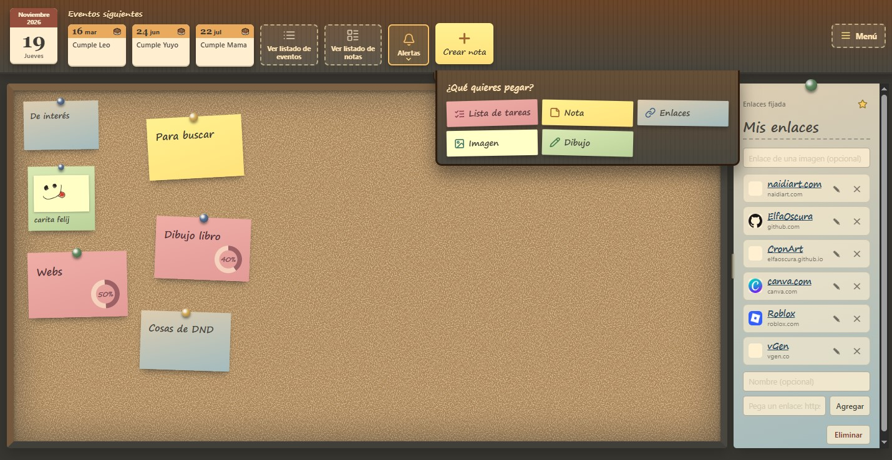
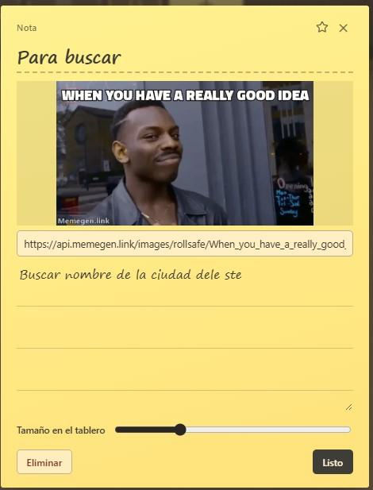
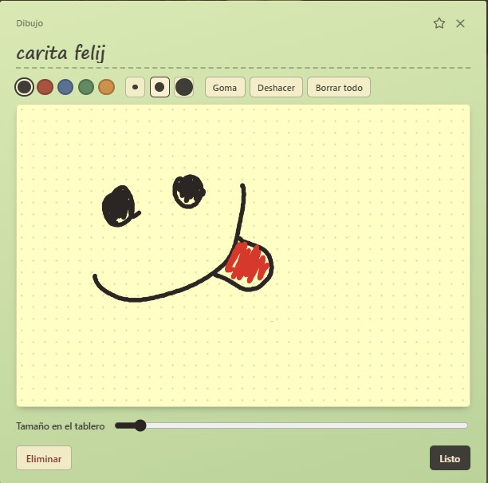

# 📌 Chincheta

**Tablero de corcho interactivo con post-its, imágenes, dibujos, alertas y calendario.**  
Funciona **sin conexión a internet** y se instala como **PWA** en escritorio y móvil.

### 🛠️ Tecnologías utilizadas

*Publicado directamente con los archivos finales listos para servir (sin proceso de compilación en el servidor/hosting).*

 

El tablero con varios post-its, los próximos eventos arriba y una nota fijada en el panel derecho.

---

## 🧭 Tabla de contenidos

* [🚀 Cómo empezar](#-cómo-empezar)
* [✨ ¿Qué puedes hacer en Chincheta?](#-qué-puedes-hacer-en-chincheta)
* [🔒 Dónde se guardan tus datos](#-dónde-se-guardan-tus-datos)
* [💾 Copias de seguridad](#-copias-de-seguridad)
* [🌐 Idiomas](#-idiomas)
* [📂 Estructura del proyecto](#-estructura-del-proyecto)
* [☕ Apoyar el proyecto](#-apoyar-el-proyecto)

---

## 🚀 Cómo empezar

1. Abre <https://elfaoscura.github.io/Chincheta/> en tu navegador (funciona tanto en escritorio como en móvil).
2. Pulsa **+ Crear nota** para añadir tu primer post-it al tablero.
3. *(Opcional)* Instálala como app desde el icono de instalación de la barra de direcciones o desde **Instalar app** en el menú `☰` para usarla como un programa más y sin conexión.

> ✨ **Sin registro ni cuentas:** empieza a usarla al instante.

---

## ✨ ¿Qué puedes hacer en Chincheta?

### 🧩 Post-its y tablero

* **Tipos de post-it:**
  * 💗​ **Rosa:** lista de tareas (con anillo de progreso que muestra el porcentaje completado).
  * 💛 **Amarillo:** nota rápida.
  * 💙 **Azul:** lista de enlaces (con vista previa que incluye icono del sitio, título y dominio; si el sitio bloquea el acceso por seguridad del navegador, se deduce del enlace).
* **Interacción táctil y con ratón:** en el tablero se muestran los títulos y las miniaturas; al hacer clic se abre el contenido completo. Puedes arrastrar las notas para moverlas y redimensionarlas desde la esquina inferior derecha en ordenador, móvil o tableta.
* **Imágenes:** sube imágenes desde tu dispositivo (o arrástralas y suéltalas directamente sobre el tablero) o añádelas desde un enlace. También puedes incluir una imagen junto al título de cualquier post-it.
* **Dibujo rápido (`💚` verde menta):** lienzo a mano alzada con ratón, dedo o lápiz, con selector de colores, grosores, goma, deshacer (`Ctrl + Z`) y limpiar lienzo.

| 💛 Nota con imagen | 💚 Dibujo a mano alzada |
| :---: | :---: |
|  |  |

### 📅 Calendario y próximos eventos

* Haz clic en la fecha de la barra superior para seleccionar un día y registrar eventos:
  * 🔔 **Evento (lila):** puntual para la fecha elegida.
  * 🎂 **Cumpleaños (naranja):** recurrente cada año (el 29 de febrero se muestra el 28 en años no bisiestos).
* Junto a la fecha aparecen los **3 próximos eventos** como tarjetas. La cuarta tarjeta, **Ver listado de eventos**, abre la vista completa para crear, editar o eliminar eventos.

### ⭐ Nota fijada

Mantén **una nota abierta a la vez** en un panel lateral derecho mientras sigues trabajando en el tablero:

* **Fijar:** haz clic en la estrella al pasar el cursor sobre una nota, dentro de una nota abierta o desde el listado de notas.
* **Ajustar ancho:** arrastra el borde izquierdo del panel, usa las flechas `←` / `→` con el borde enfocado o haz doble clic para volver al tamaño original. El ancho se guarda automáticamente.
* **Cambiar o desfijar:** si ya hay una nota fijada, Chincheta te avisa cuál es y te pregunta si deseas reemplazarla. Al pulsar la estrella del panel, la nota vuelve a su posición original en el tablero. *(Las alertas no se pueden fijar; en pantallas estrechas el panel aparece debajo del tablero).*

### 🔔 Alertas

Desde el botón **Alertas** (borde naranja) puedes alternar entre **Ver alertas** y **Crear alerta**:

* Configura título, descripción, hora y repetición (una sola vez, **todos los días** o **días específicos** de lunes a domingo). Puedes pausarlas, editarlas o eliminarlas en cualquier momento.
* En el tablero aparecen como post-its **naranjas** con cuenta atrás en vivo y cambio de color según la urgencia: **verde** (sin prisa), **amarilla** ($\le 3\text{ h}$), **roja** ($\le 15\text{ min}$ o vencida) y **gris** (en pausa).
* A la hora programada emiten un sonido suave, muestran una notificación del sistema (si concedes el permiso) y abren un aviso con **Descartar** o **Prorrogar 10 minutos** (el audio también puede silenciarse).

> ⏰ **Nota sobre alertas:** Funcionan mientras Chincheta esté abierta (en una pestaña o como app instalada, incluso en segundo plano). Al no haber un servidor externo de notificaciones push, no avisan con la app cerrada, pero al abrirla verás de inmediato las alertas vencidas.

### 🔍 Navegación, búsqueda y listado de notas

* **Listado de notas:** ideal cuando el tablero tiene muchas notas. Permite filtrar por texto o tipo, abrir una nota, **localizarla en el tablero** (con un breve resalte) o fijarla.
* **Buscador global:** accesible desde el menú `☰` o con los atajos `/` y `Ctrl + K`. Filtra en tiempo real notas, tareas, enlaces, alertas y eventos sin distinguir mayúsculas ni tildes, atenuando lo que no coincide. Pulsa `Enter` para abrir el primer resultado o `Esc` para limpiar.
* **Barra superior plegable:** usa la flecha centrada bajo la barra para ocultarla y ganar espacio en el tablero (se recuerda tu preferencia). Los atajos `/` y `Ctrl + K` también la despliegan al abrir el buscador.

---

## 🔒 Dónde se guardan tus datos

**Todo se almacena localmente en tu navegador y en tu dispositivo.** Chincheta no tiene servidor ni base de datos: tus notas nunca salen de tu equipo ni son visibles para quien aloja la página.

| Contenido | Almacenamiento | Clave / Identificador |
| :--- | :--- | :--- |
| Post-its, alertas, eventos y ajustes (incluida la nota fijada y su ancho) | `localStorage` | `chincheta:datos:v1` |
| Preferencias de la barra superior | `localStorage` | `chincheta:ui:v1` |
| Imágenes locales y dibujos | `IndexedDB` | BD `chincheta-imagenes`, almacén `imagenes` |
| Idioma seleccionado | `localStorage` | `chincheta:lang` |
| Caché sin conexión (PWA) | Caché del Service Worker | `chincheta-v13` (ver `sw.js`) |

Ten en cuenta en el día a día:

* **Aislamiento por origen y navegador:** los datos pertenecen a cada navegador y dirección concretos (por ejemplo, lo guardado en `elfaoscura.github.io` no se verá en `localhost:8080`, ni automáticamente entre distintos navegadores o dispositivos).
* **Riesgo de borrado:** se pueden perder si limpias los datos del sitio/navegador, usas navegación privada o el sistema libera espacio. La app solicita almacenamiento persistente cuando es posible, aunque no está garantizado en todos los entornos.
* **Sin sincronización automática:** no hay sincronización en la nube entre equipos.
* **Espacio disponible:** depende del límite que asigne el navegador (habitualmente cientos de MB), suficiente para texto y moderado si guardas imágenes de gran peso.

---

## 💾 Copias de seguridad

Dado que los datos residen en el navegador, conviene exportar respaldos periódicamente —y siempre antes de limpiar datos de navegación o cambiar de equipo— desde el menú `☰`:

* **Guardar respaldo:** descarga un archivo `chincheta-respaldo-AAAA-MM-DD_HHMM.json` con post-its, alertas, dibujos, imágenes locales, calendario y configuración.
* **Cargar respaldo:** restaura un archivo de respaldo en cualquier navegador o dispositivo *(reemplaza los datos actuales)*.

---

## 🌐 Idiomas

Desde el menú `☰` puedes cambiar entre **Español**, **English** y **中文**. La app detecta inicialmente el idioma del navegador si está disponible y recuerda tu elección. Solo cambia la interfaz, meses, días y formatos de fecha/hora; el contenido de tus notas y eventos no se traduce.

---

## 📂 Estructura del proyecto

| Archivo / Carpeta | Descripción |
| :--- | :--- |
| `index.html` | Estructura principal de la página y modales |
| `styles.css` | Estilos visuales (corcho, post-its, calendario, diseño adaptable) |
| `app.js` | Lógica principal de la aplicación y el tablero |
| `alerts.js` | Gestión de alertas, cuentas atrás, notificaciones y sonido |
| `dock.js` | Panel lateral de nota fijada |
| `notes.js` | Vista y filtros del listado de notas |
| `i18n.js` | Gestión de idiomas (`t()`), formatos de fecha y textos base |
| `i18n/es.js`, `i18n/en.js`, `i18n/zh.js` | Diccionarios de traducción (español, inglés y chino) |
| `draw.js` | Herramienta de dibujo en post-its |
| `links.js` | Generación y vista previa de tarjetas de enlaces |
| `search.js` | Buscador global en vivo |
| `lucide.js` | Iconos [Lucide](https://lucide.dev) a color incluidos en local para funcionar sin conexión |
| `tools.js` | Menú principal, creación de notas, submenú de alertas y plegado de barra |
| `manifest.json` | Metadatos de la PWA para instalación |
| `sw.js` | Service Worker para caché y funcionamiento sin conexión |
| `icons/` | Iconos de la aplicación |
| `miniatura-chincheta.jpg` | Imagen de vista previa al compartir el enlace (Open Graph) |
| `screen-tablero.jpg`, `nota.jpg`, `nota-dibujo.jpg` | Capturas que se muestran en este README (no las usa la app) |

---

## ☕ Apoyar el proyecto

Chincheta es gratuita y de uso libre. Si te resulta útil y quieres apoyar el proyecto, el menú `☰` incluye el enlace **Invítame un café** hacia <https://ko-fi.com/naidi_art> (completamente opcional).
